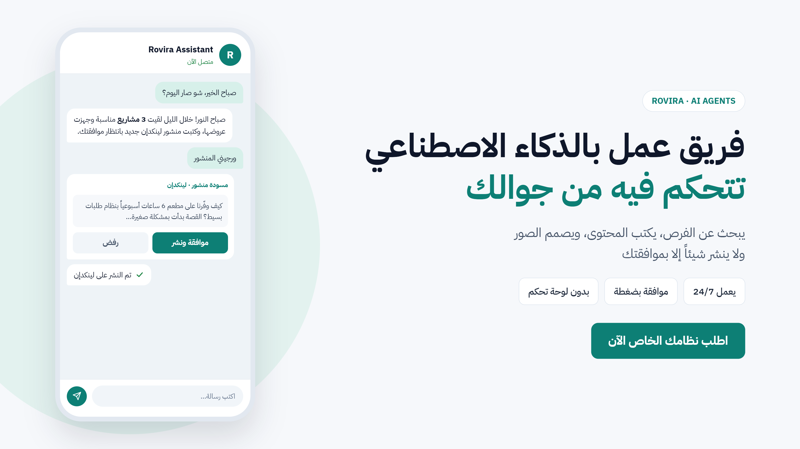
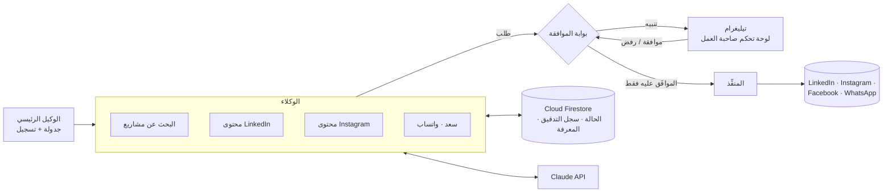
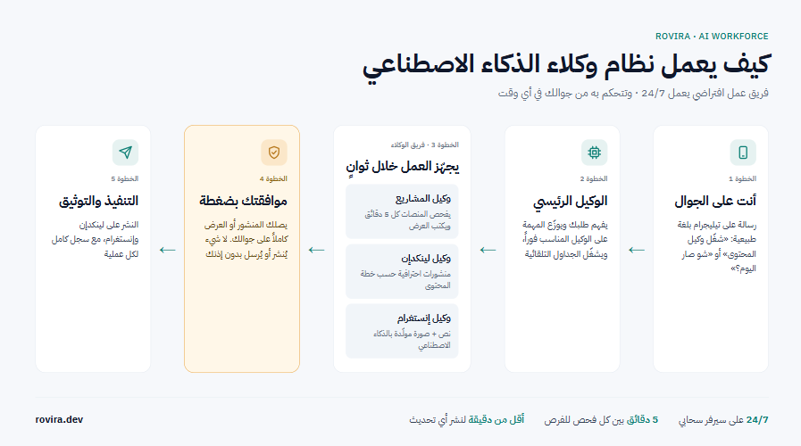
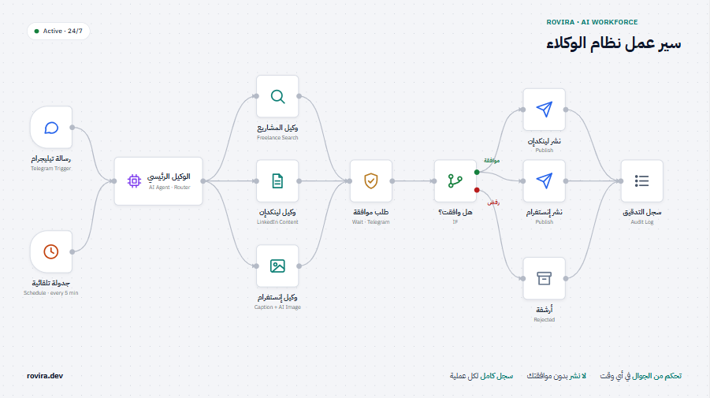
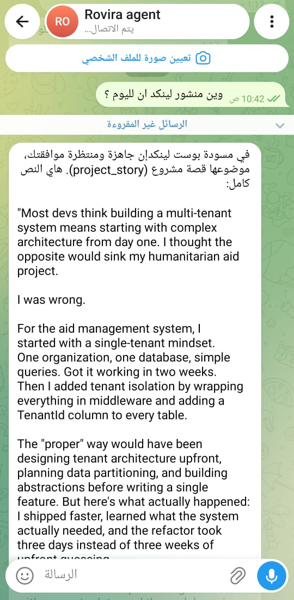
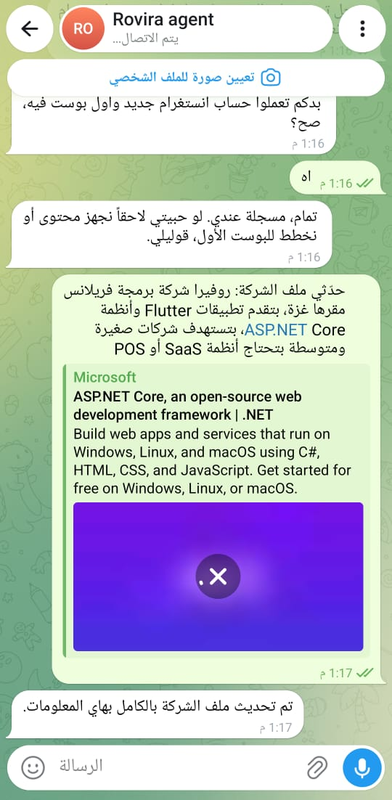

# Rovira AI Workforce — نسخة العرض

[Read in English](README.md) · **العربية**

> نظام ذكاء اصطناعي متعدد الوكلاء يدير العمليات اليومية لاستوديو برمجيات صغير
> (البحث عن مشاريع العمل الحر، وإنتاج محتوى السوشال ميديا، والرد على العملاء عبر واتساب)،
> مع **بوابة موافقة بشرية (Human-in-the-loop)** على كل إجراء يتعامل مع العالم الخارجي.

> ℹ️ هذا المستودع للعرض العام. يحتوي على الكود المصدري الأساسي (الوكلاء، وبوابة الموافقة، والتكاملات).
> إعدادات النشر والمفاتيح وبيانات العمل الخاصة غير موجودة، لذلك لا يعمل الكود كما هو
> بدون ملف `.env` ومشروع Firebase خاصين به.
>
> © ريم منصور. جميع الحقوق محفوظة. الكود معروض للاطلاع فقط، ولا يجوز استخدامه أو نسخه
> أو تعديله أو إعادة نشره بدون إذن كتابي.

---

## 🎯 المشكلة

صاحب المشروع المستقل أو الاستوديو الصغير يقضي ساعات كل أسبوع في أعمال متكررة لكنها تحتاج حُكماً وتقديراً:

- تصفّح منصات العمل الحر بحثاً عن مشاريع مناسبة وكتابة العروض
- إبقاء حسابات LinkedIn وInstagram نشطة بمنشورات متّسقة مع هوية العلامة التجارية
- الرد على نفس أسئلة العملاء على واتساب، وغالباً خارج ساعات العمل
- فرز العملاء المحتملين القادمين من الموقع قبل بدء محادثة حقيقية

الذكاء الاصطناعي المستقل بالكامل مخاطرة هنا: رسالة أو سعر أو منشور خاطئ واحد يصل مباشرة إلى عميل حقيقي.

## 💡 الحل

فريق من وكلاء الذكاء الاصطناعي المتخصصين، ينسّق بينهم منظِّم مركزي، يتولى العمل الروتيني.
**الوكلاء يكتبون المسودات والإنسان يقرّر.** كل إجراء خارجي أو تجاري ينتظر موافقة بضغطة واحدة
على تيليغرام قبل تنفيذه.

---

## 🤖 الوكلاء

| الوكيل | ماذا يفعل |
|---|---|
| **وكيل البحث عن مشاريع العمل الحر** | يتابع منصات العمل الحر بشكل دوري، ويفلتر المشاريع حسب ملف المهارات، ويكتب عرضاً مخصصاً فقط للمشاريع شديدة التطابق |
| **وكيل محتوى LinkedIn** | يكتب مسودات المنشورات من قائمة أفكار أو من مشاريع سابقة حقيقية، وفق جدول أسبوعي |
| **وكيل محتوى Instagram** | يكتب النص والعنوان، ثم يختار لقطة شاشة حقيقية لمنتج أو يولّد مشهداً بالذكاء الاصطناعي، ويصمم صورة نهائية بمقاس 1080×1350 متوافقة مع الهوية |
| **سعد: وكيل خدمة العملاء على واتساب** | يجيب على أسئلة العملاء بالعربية، حصراً من ملفات المنتجات المعتمدة. ويحوّل المحادثة لإنسان فور عجزه عن الإجابة |
| **مسار العملاء المحتملين** | مسار تأهيل مكتوب مسبقاً (بدون ذكاء اصطناعي) لعملاء الموقع: نوع المشروع ← الميزانية ← موعد البدء. ويرسل ملخصاً فورياً مرتباً حسب الأولوية لصاحبة العمل |

---

## 🏗️ البنية (نظرة عامة)

### الأمان جزء من التصميم

- **المنع هو الأصل.** كل نوع إجراء مصنّف إما *داخلي* (آمن للتنفيذ تلقائياً) أو *مقيّد بموافقة*. وأي إجراء غير مصنّف صراحةً كداخلي يُعامل كمقيّد.
- **باب واحد فقط.** لا يملك الوكلاء أي دالة للإرسال أو النشر أو الدفع. كل ما يستطيعونه هو *طلب الموافقة*.
- **المنفِّذ يتحقق مرتين.** يعيد التحقق من حالة الموافقة بنفسه قبل التنفيذ، ويتحقق من النتيجة بعده.
  دورة الحياة: `WAITING_APPROVAL → APPROVED → EXECUTED → VERIFIED`
- **سجل تدقيق للإضافة فقط.** كل إجراء يُسجَّل، سواء كان محاولة أو محظوراً أو موافقاً عليه أو منفّذاً.
- **ضوابط صارمة لوكيل العملاء.** فحوصات على مستوى الكود تمنع أي سعر أو موعد أو خصم أو وعد غير موجود في الكتالوج المعتمد، مهما كتب النموذج.
- **مسودة واحدة في كل مرة.** وكلاء المحتوى لا يكدّسون مسودات غير مُراجَعة.

---

## ✨ الميزات الرئيسية

- 📲 **تيليغرام كلوحة تحكم:** الموافقة على المسودات ورفضها، وتشغيل الوكلاء عند الطلب، واستلام ملخص يومي
- 💬 **تيليغرام كصندوق وارد لواتساب:** كل محادثة عميل تظهر كسلسلة رسائل. الرد بالسحب على تيليغرام يصل مباشرة للعميل، والبوت ينسحب تلقائياً إلى "الوضع البشري"
- 🧠 **وكيل عملاء قابل للتدريب:** القواعد، وأزواج الأسئلة والأجوبة المعتمدة، وردود صاحبة العمل نفسها تُتعلَّم كأمثلة للأسلوب، وكل ذلك بدون تعديل الكود
- 🎨 **صور متّسقة مع الهوية:** العناوين تُرسم بالكود (وليس بنموذج توليد الصور أبداً) باستخدام دليل هوية ثابت
- 📊 **تسجيل العملاء المحتملين والأسئلة** في Google Sheets للمراجعة لاحقاً
- 🔁 **CI/CD:** كل push على `main` يُنشر على الإنتاج تلقائياً مع فحص لسلامة التشغيل

---

## 🧰 التقنيات المستخدمة

**بيئة التشغيل:** Node.js (ES modules) · Express
**الذكاء الاصطناعي:** Anthropic Claude API · OpenAI image generation
**البيانات:** Cloud Firestore · Firebase Cloud Functions · Google Sheets API
**قنوات التواصل:** WhatsApp Cloud API (Meta) · Telegram Bot API · LinkedIn API · Instagram Graph API · Facebook Pages API
**التشغيل والبنية التحتية:** DigitalOcean (Linux VPS) · systemd · GitHub Actions (self-hosted runner) · Nginx · Cloudflare

---

## 📸 لقطات الشاشة

**كيف يعمل النظام:** رسالة على تيليغرام ← الوكيل الرئيسي يوزّع المهمة ← الوكلاء المتخصصون يجهّزون المسودة ← موافقة بضغطة ← النشر وتسجيله في سجل التدقيق.

**سير عمل الوكلاء:** المحفّزات، والتوزيع، ومسار الموافقة (موافقة ← نشر / رفض ← أرشفة)، وسجل التدقيق.

**تيليغرام أثناء العمل:**

<table>
  <tr>
    <td align="center"></td>
    <td align="center"></td>
  </tr>
  <tr>
    <td align="center">مسودة منشور لينكدإن بانتظار الموافقة</td>
    <td align="center">تحديث معرفة الشركة بلغة طبيعية</td>
  </tr>
</table>

---

## 📈 الأثر

- 🌙 **رد أولي على مدار الساعة** للعملاء على واتساب، بدون أي خطر أن يخترع البوت أسعاراً أو التزامات
- 🎯 **تركيز الانتباه:** فقط المشاريع شديدة التطابق والعملاء الجادّون يصلون لصاحبة العمل
- 🚀 **نشر آلي وسريع:** كل push على `main` يُنشر تلقائياً؛ الزمن الوسيط للنشر حوالي 26 ثانية (من سجل تشغيلات GitHub Actions، أكتوبر 2026)

---

## 👩‍💻 المطوّرة

**ريم منصور** · [rovira.dev](https://rovira.dev) · [LinkedIn](https://linkedin.com/in/reem-mansour-a76938247)
