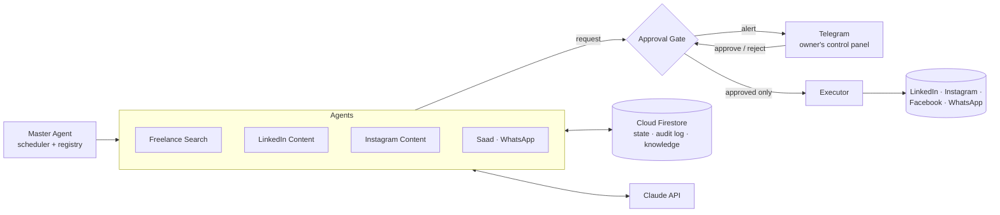

# Rovira AI Workforce — Showcase

**English** · [اقرأ بالعربية](README.ar.md)

> A multi-agent AI system that runs the day-to-day operations of a small software studio
> (finding freelance work, producing social content, and answering customers on WhatsApp),
> with a **human-in-the-loop approval gate** on every action that touches the outside world.

> ℹ️ This repository is a public showcase. It contains the core source code (agents, approval gate,
> integrations). Deployment configuration, credentials, and private business data are not included,
> so the code does not run as-is without its own `.env` and Firebase project.
>
> © Reem Mansour. All rights reserved. The code is shared for viewing only. It may not be used,
> copied, modified, or redistributed without written permission.

---

## 🎯 The Problem

A solo founder or small studio spends hours every week on work that is repetitive but still needs judgment:

- Scanning freelance platforms for relevant projects and writing proposals
- Keeping LinkedIn and Instagram active with consistent, on-brand posts
- Answering the same customer questions on WhatsApp, often outside working hours
- Qualifying website leads before a real conversation starts

Fully autonomous AI is risky here: one wrong message, price, or post goes straight to a real client.

## 💡 The Solution

A team of specialised AI agents, coordinated by a central orchestrator, handles the routine work.
**The agents draft and a human decides.** Every external or commercial action waits for one-tap
approval on Telegram before it runs.

---

## 🤖 The Agents

| Agent | What it does |
|---|---|
| **Freelance Search Agent** | Polls freelance platforms on a schedule, filters projects against a skills profile, and drafts a tailored proposal only for strong matches |
| **LinkedIn Content Agent** | Drafts posts from a queue of ideas or from real past projects, on a weekly cadence |
| **Instagram Content Agent** | Writes the caption and headline, then picks a real product screenshot or generates an AI scene, and composes a finished, on-brand 1080×1350 image |
| **Saad: WhatsApp Customer Agent** | Answers customer questions in Arabic, strictly from approved product sheets. Hands the chat over to a human the moment it can't answer |
| **Lead Flow** | A scripted (non-AI) qualification flow for website leads: project type → budget → timeline. Sends an instant, prioritised summary to the owner |

---

## 🏗️ Architecture (high level)

### Safety by design

- **Deny by default.** Every action type is classified as *internal* (safe to run on its own) or *gated*. Anything not explicitly marked internal is gated.
- **Single door.** Agents have no function that sends, publishes, or pays. They can only *request approval*.
- **Executor double-checks.** It re-verifies the approval state itself before running and verifies the result afterwards.
  Lifecycle: `WAITING_APPROVAL → APPROVED → EXECUTED → VERIFIED`
- **Append-only audit log.** Every action, whether attempted, blocked, approved, or executed, is recorded.
- **Hard guardrails for the customer agent.** Code-level checks block any price, date, discount, or promise that isn't in the approved catalogue, whatever the model generates.
- **One draft at a time.** Content agents never pile up unreviewed drafts.

---

## ✨ Key Features

- 📲 **Telegram as a control panel:** approve and reject drafts, trigger agents on demand, and get a daily summary
- 💬 **Telegram as a WhatsApp inbox:** every customer conversation is mirrored as a thread. Swipe-reply on Telegram goes straight to the customer, and the bot steps back into "human mode" automatically
- 🧠 **Trainable customer agent:** rules, approved Q&A pairs, and the owner's own replies are learned as style examples, all without code changes
- 🎨 **Brand-consistent visuals:** headlines are rendered in code (never by the image model), using a fixed brand kit
- 📊 **Lead and question logging** to Google Sheets for later review
- 🔁 **CI/CD:** every push to `main` deploys to production automatically, with a health check

---

## 🧰 Tech Stack

**Runtime:** Node.js (ES modules) · Express
**AI:** Anthropic Claude API · OpenAI image generation
**Data:** Cloud Firestore · Firebase Cloud Functions · Google Sheets API
**Channels:** WhatsApp Cloud API (Meta) · Telegram Bot API · LinkedIn API · Instagram Graph API · Facebook Pages API
**Ops:** DigitalOcean (Linux VPS) · systemd · GitHub Actions (self-hosted runner) · Nginx · Cloudflare

---

## 📸 Screenshots

> The interface is in Arabic: the system is built for an Arabic-speaking market.

**How it works:** a message on Telegram → the Master Agent routes it → specialised agents draft → one-tap approval → publish and audit log.

**Agent workflow:** triggers, routing, approval branch (approve → publish / reject → archive), and the audit log.

**Telegram in action:**

<table>
  <tr>
    <td align="center"></td>
    <td align="center"></td>
  </tr>
  <tr>
    <td align="center">A LinkedIn draft waiting for approval</td>
    <td align="center">Updating the company knowledge in plain language</td>
  </tr>
</table>

---

## 📈 Impact

- 🌙 **24/7 first response** to customers on WhatsApp, with no risk of the bot inventing prices or commitments
- 🎯 **Focused attention:** only strong freelance matches and hot leads reach the owner
- 🚀 **Fast, automated delivery:** every push to `main` deploys itself; median deploy time ~26 s (from GitHub Actions run history, October 2026)

---

## 👩‍💻 Author

**Reem Mansour** · [rovira.dev](https://rovira.dev) · [LinkedIn](https://linkedin.com/in/reem-mansour-a76938247)
